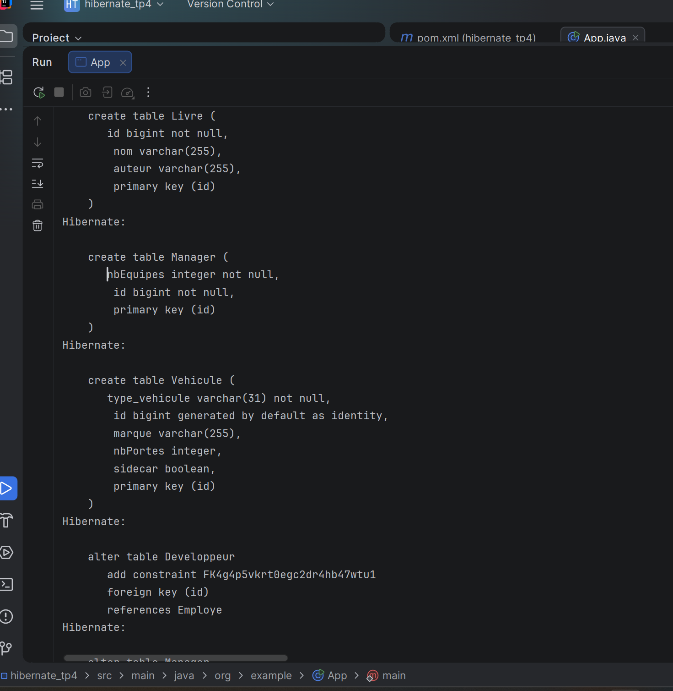
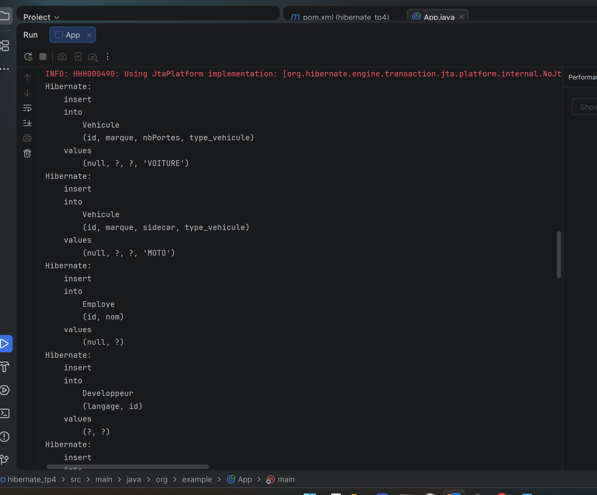
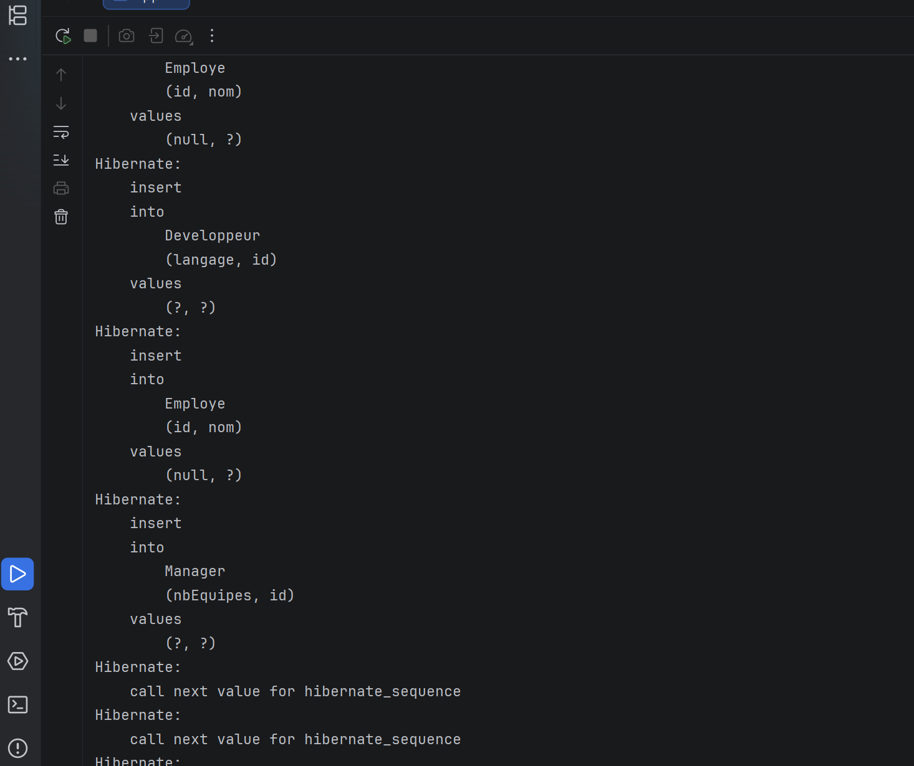
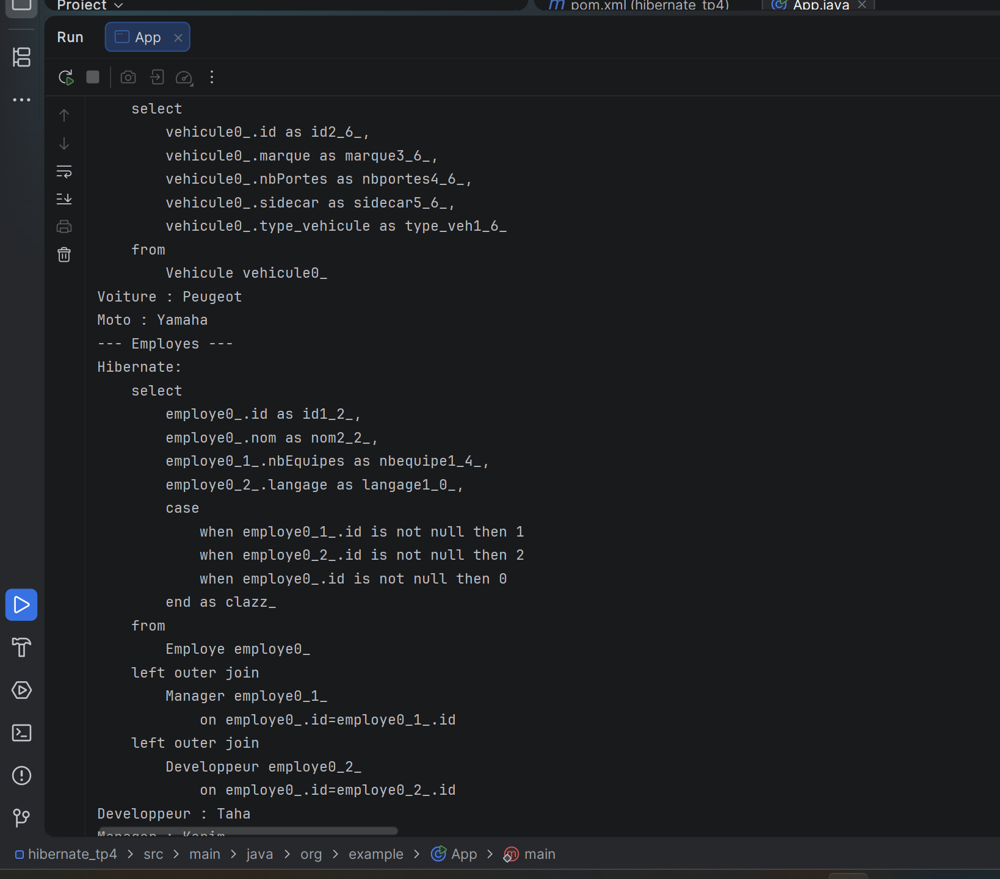
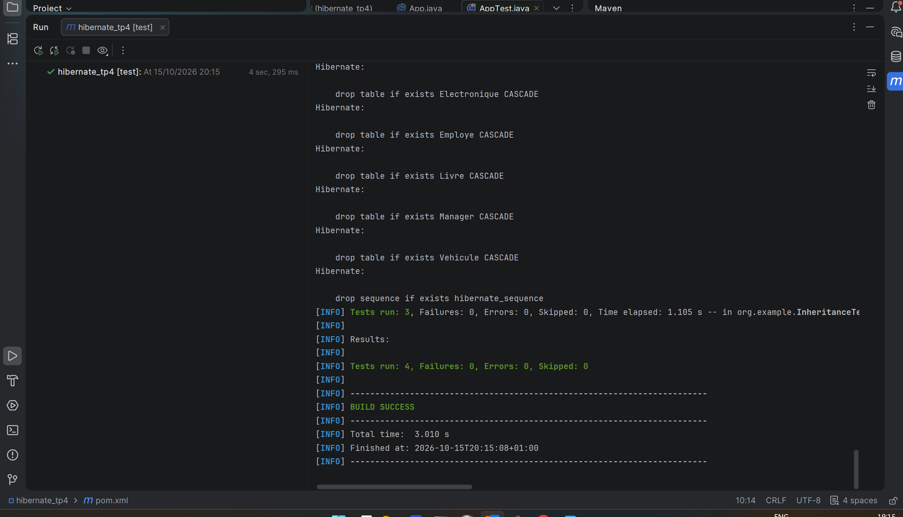

Execution de App (demarrage + creation des tables) :

```console
Oct 15, 2026 8:18:37 PM org.hibernate.jpa.internal.util.LogHelper logPersistenceUnitInformation
INFO: HHH000204: Processing PersistenceUnitInfo [name: hibernate-inheritance]
Oct 15, 2026 8:18:37 PM org.hibernate.Version logVersion
INFO: HHH000412: Hibernate ORM core version 5.4.30.Final
Oct 15, 2026 8:18:37 PM org.hibernate.annotations.common.reflection.java.JavaReflectionManager <clinit>
INFO: HCANN000001: Hibernate Commons Annotations {5.1.2.Final}
Oct 15, 2026 8:18:37 PM org.hibernate.engine.jdbc.connections.internal.DriverManagerConnectionProviderImpl configure
WARN: HHH10001002: Using Hibernate built-in connection pool (not for production use!)
Oct 15, 2026 8:18:37 PM org.hibernate.engine.jdbc.connections.internal.DriverManagerConnectionProviderImpl buildCreator
INFO: HHH10001005: using driver [org.h2.Driver] at URL [jdbc:h2:mem:testdb;DB_CLOSE_DELAY=-1]
Oct 15, 2026 8:18:37 PM org.hibernate.engine.jdbc.connections.internal.DriverManagerConnectionProviderImpl buildCreator
INFO: HHH10001001: Connection properties: {user=sa, password=****}
Oct 15, 2026 8:18:37 PM org.hibernate.engine.jdbc.connections.internal.DriverManagerConnectionProviderImpl buildCreator
INFO: HHH10001003: Autocommit mode: false
Oct 15, 2026 8:18:37 PM org.hibernate.engine.jdbc.connections.internal.DriverManagerConnectionProviderImpl$PooledConnections <init>
INFO: HHH000115: Hibernate connection pool size: 20 (min=1)
Oct 15, 2026 8:18:37 PM org.hibernate.dialect.Dialect <init>
INFO: HHH000400: Using dialect: org.hibernate.dialect.H2Dialect
Hibernate: drop table if exists Developpeur CASCADE
Hibernate: drop table if exists Electronique CASCADE
Hibernate: drop table if exists Employe CASCADE
Hibernate: drop table if exists Livre CASCADE
Hibernate: drop table if exists Manager CASCADE
Hibernate: drop table if exists Vehicule CASCADE
Hibernate: drop sequence if exists hibernate_sequence
Hibernate: create sequence hibernate_sequence start with 1 increment by 1
Hibernate: create table Developpeur (langage varchar(255), id bigint not null, primary key (id))
Hibernate: create table Electronique (id bigint not null, nom varchar(255), garantieMois integer not null, primary key (id))
Hibernate: create table Employe (id bigint generated by default as identity, nom varchar(255), primary key (id))
Hibernate: create table Livre (id bigint not null, nom varchar(255), auteur varchar(255), primary key (id))
Hibernate: create table Manager (nbEquipes integer not null, id bigint not null, primary key (id))
Hibernate: create table Vehicule (type_vehicule varchar(31) not null, id bigint generated by default as identity, marque varchar(255), nbPortes integer, sidecar boolean, primary key (id))
Hibernate: alter table Developpeur add constraint FK4g4p5vkrt0egc2dr4hb47wtu1 foreign key (id) references Employe
Hibernate: alter table Manager add constraint FK6hmkdbslllkls15yt8sgiy4nt foreign key (id) references Employe
```



Insertion des vehicules, une seule table avec discriminant VOITURE / MOTO :

```console
Hibernate: insert into Vehicule (id, marque, nbPortes, type_vehicule) values (null, ?, ?, 'VOITURE')
Hibernate: insert into Vehicule (id, marque, sidecar, type_vehicule) values (null, ?, ?, 'MOTO')
```



Insertion des employes (2 inserts par objet) et des produits (sequence + table propre) :

```console
Hibernate: insert into Employe (id, nom) values (null, ?)
Hibernate: insert into Developpeur (langage, id) values (?, ?)
Hibernate: insert into Employe (id, nom) values (null, ?)
Hibernate: insert into Manager (nbEquipes, id) values (?, ?)
Hibernate: call next value for hibernate_sequence
Hibernate: call next value for hibernate_sequence
Hibernate: insert into Livre (nom, auteur, id) values (?, ?, ?)
Hibernate: insert into Electronique (nom, garantieMois, id) values (?, ?, ?)
```



Lecture polymorphique, les 3 listes avec le bon type concret :

```console
--- Vehicules ---
Hibernate: select vehicule0_.id, vehicule0_.marque, vehicule0_.nbPortes, vehicule0_.sidecar, vehicule0_.type_vehicule from Vehicule vehicule0_
Voiture : Peugeot
Moto : Yamaha
--- Employes ---
Hibernate: select employe0_.id, employe0_.nom ... from Employe employe0_ left outer join Manager employe0_1_ on employe0_.id=employe0_1_.id left outer join Developpeur employe0_2_ on employe0_.id=employe0_2_.id
Developpeur : Taha
Manager : Karim
--- Produits ---
Hibernate: select ... from (select id, nom, garantieMois, null as auteur, 1 as clazz_ from Electronique union all select id, nom, null as garantieMois, auteur, 2 as clazz_ from Livre) produit0_
Electronique : Ecran Samsung
Livre : Effective Java
Process finished with exit code 0
```



Tests JUnit, les 3 strategies passent :

```console
Tests run: 3, Failures: 0, Errors: 0, Skipped: 0 -- in org.example.InheritanceTest
Tests run: 4, Failures: 0, Errors: 0, Skipped: 0
BUILD SUCCESS
```


